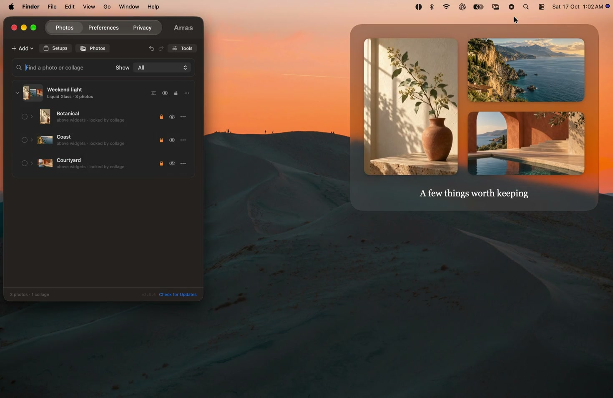
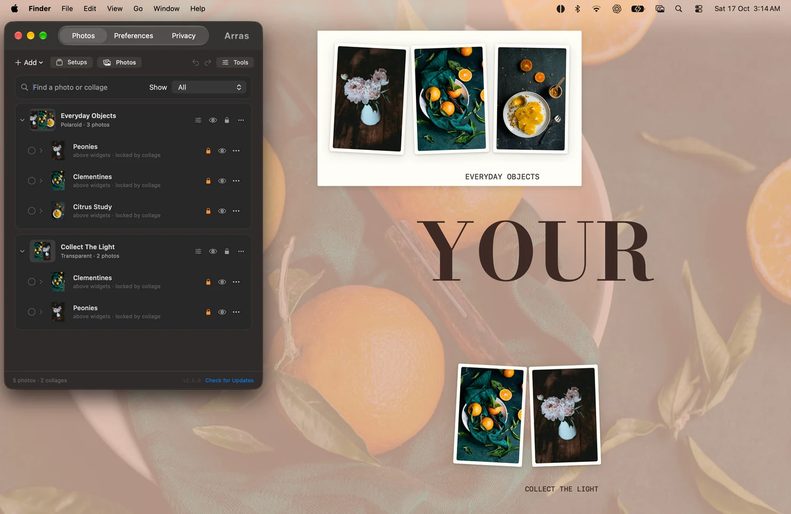

# Arras

**Your photos. Your kind of desktop.**

[Website](https://tryarras.tech/) · [Download for macOS](https://tryarras.tech/download?ref=github) · [FAQ](https://tryarras.tech/faq) · [Security & Privacy](https://tryarras.tech/security)

Arras is a free, open-source Mac app for photos, slideshows and editable desktop
collages. Keep a photo’s natural proportions, choose its look and layer, and
arrange a desktop that feels like yours.

[](https://tryarras.tech/puremac/arras/launch-2.5.0.mp4)

**[Watch the launch film](https://tryarras.tech/puremac/arras/launch-2.5.0.mp4)** — real Arras windows on a Mac desktop, with sample artwork. No audio required.

   [](https://github.com/yashashwi-s/Arras/releases/latest)

## Distribution

The free direct download below remains available. This repository also contains
a sandboxed **ArrasAppStore** target for a planned $4.99 Mac App Store edition.
It is not yet available on the App Store. Its signed 2.5.0 beta was installed
through TestFlight and is **Waiting for Review**, with manual release selected. Both targets
share the widget and collage code; Store updates come through Apple and that
build excludes app telemetry. See [build guidance](CONTRIBUTING.md#app-store-target).

## Download Arras 2.5.0

**[Download the DMG](https://tryarras.tech/download?ref=github)** · [Release notes and ZIP](https://github.com/yashashwi-s/Arras/releases/tag/v2.5.0)

Requires **macOS 14 Sonoma or later**. One universal app supports **Apple Silicon
and Intel**. The official 2.5.0 app and DMG are **Developer ID signed and notarized
by Apple**, with stapled tickets. Open the DMG, drag Arras to Applications, then
open it. macOS may ask you to confirm opening an app downloaded from the internet.

Arras is MIT-licensed and free, with no account or subscription. Photos and layouts
stay on your Mac. Version 2.5.0 sends limited usage and weekly configuration
statistics; photos, filenames, paths, layouts and personal content are excluded.
Read [Security & Privacy](https://tryarras.tech/security) for permissions,
network behavior and retention.

## Make the desktop yours

- **Editable collages.** Move a group by its background, or move and resize each
  photo independently. Its boundary grows and shrinks as you work. Choose a
  material, spacing, captions and freely placed text labels.
- **Slideshows and linked collections.** Rotate local photos, link a Finder folder
  or Photos album, and keep a managed snapshot for offline use. Add still images,
  GIF/APNG animations and local videos.
- **Layers and placement.** Choose Behind Icons, On Desktop, Above Widgets or
  Floating. Snap, align, distribute and lock widgets. Collages own their depth and
  Space pinning while keeping each photo’s standalone values for detaching.
- **Your own look.** Use visual presets, masks, mats, frames, tilt, opacity,
  shadows and gradients. Copy appearance between photos. Crop, rotate, flip or
  grayscale a reference without rewriting its managed original.
- **Room to experiment.** Undo arrangement changes, save named desktop setups,
  restore the previous setup and recover the most recently removed widgets.
  Export a portable `.arras` backup when you want to keep or share a layout.
- **Native Mac controls.** A compact menu bar app, Shortcuts actions, configurable
  update checks, a global visibility shortcut and dedicated Privacy controls.

[](https://tryarras.tech/#details)

See [more real screenshots](https://tryarras.tech/#workflows), the
[2.5.0 feature guide](FEATURES.md) and [changelog](CHANGELOG.md#250) for details.

## Start here

1. Open Arras Settings from its menu bar icon. Use **Add → Try an Example** for an
   editable collage, moodboard or slideshow, or add your own photos.
2. Drag a photo to move it; drag a corner to resize. A collage’s background moves
   its whole group, while its photos remain independently editable.
3. Use **Tools** to change appearance or reference edits. Save a setup before
   experimenting with another arrangement.
4. Use **Preferences** for app-wide behavior and updates, and **Privacy** for
   capture and presence controls. Capture exclusion is a compatibility request;
   manually hide widgets before a recording that must exclude them.

Arras has no Dock icon and does not appear in Command-Tab. It was previously
Photo Widget OSX and Tableau; its bundle identifier and Application Support
location stay compatible with existing installations.

## Build and test

Arras uses Apple frameworks and has no third-party runtime dependencies. Install
XcodeGen and Xcode with the macOS 27 SDK for the current Settings appearance.
The deployment target is macOS 14.

```sh
brew install xcodegen
./build.sh
```

`./build.sh --run` launches the validated local build. `./build.sh --release`
creates ad-hoc development packages; official distribution uses the separate
Developer ID signing and notarization step. Builds record their source digest,
and packaging rejects stale source or LLVM coverage instrumentation.
See [CONTRIBUTING.md](CONTRIBUTING.md#build-and-test) for testing and release checks.
Tests must use isolated storage and never the user’s personal library.

## Project documents

- [FEATURES.md](FEATURES.md): user-facing behavior, controls and limits.
- [ARCHITECTURE.md](ARCHITECTURE.md): subsystem ownership and compatibility.
- [SECURITY.md](SECURITY.md): signing, permissions, network activity and telemetry.
- [CONTRIBUTING.md](CONTRIBUTING.md): build, verification and release guidance.
- [CHANGELOG.md](CHANGELOG.md) and [release notes](release-notes/2.5.0.json): version history.

Found a problem? [Open an issue](https://github.com/yashashwi-s/Arras/issues/new/choose).
If Arras makes your desktop better, [star the repository](https://github.com/yashashwi-s/Arras).
